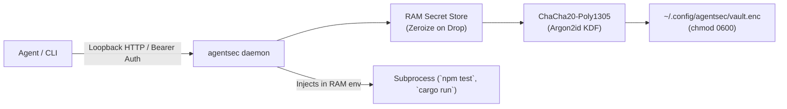

# agentsec 🔒

> A secure, namespaced secret management daemon and CLI for AI coding agents and developers.

Coding agents (Antigravity, Cursor, Claude Code, Aider, custom LLM CLI tools) frequently handle API keys, database connection strings, SSH keys, and third-party credentials. Writing `.env` files directly into workspace repositories risks accidental Git commits, leaking keys in `git diff` outputs, and exposing credentials in AI context logs.

**agentsec** solves this by maintaining secrets in an isolated, encrypted background vault outside the project directory. Agents and developers can securely store, query, and inject secrets directly into subprocess memory environment variables without ever touching the disk.

---

## 🌟 Key Features

- **Namespaced Scoping**: Group secrets by project/workspace (`repo:<name>`), agent session (`agent:<session_id>`), or custom domains (`prod`, `staging`, `global`). Defaults automatically to the current Git repository!
- **Zero-File In-Memory Process Injection**: Run commands with `agentsec run -- <command>` (e.g. `agentsec run -- npm test`). Secrets are injected directly into child process RAM environment variables. No `.env` file is ever written to disk.
- **Hardware-Grade Cryptography & Memory Sanitization**:
  - **Zeroize on Drop**: Protected memory structures wipe raw secrets from RAM immediately upon release.
  - **AEAD Encryption**: Storage is encrypted at rest using ChaCha20-Poly1305 with keys derived via Argon2id.
  - **Ephemeral Mode**: Pass `--ephemeral` to run strictly in RAM without touching disk (ideal for ephemeral CI/CD or sandboxed agent sessions).
- **Masked Previews by Default**: List operations display safe previews (e.g. `sk-a...****...2345`) to prevent accidental leaks in terminal scrollback or agent logs.
- **TTL / Auto-Expiring Leases**: Assign time-to-live (`--ttl <seconds>`) to temporary credentials so they self-destruct automatically.
- **Model Context Protocol (MCP) Server**: Built-in MCP stdio server (`agentsec mcp`) for plug-and-play integration with AI coding agents.
- **Workspace Secret Leak Scanner**: Built-in `agentsec scan` audits files in the repository to guarantee no stored secrets have leaked into plaintext code.

---

## 🚀 Quick Start

### 1. Build the Binary
```bash
cargo build --release
# Binary will be at target/release/agentsec
```

### 2. Start the Daemon
```bash
agentsec daemon
```

To run in ephemeral RAM-only mode (secrets exist only as long as the daemon is running):
```bash
agentsec daemon --ephemeral
```

### 3. Check Daemon Status
```bash
agentsec status
```
```text
Daemon Status:    ONLINE
Process ID:       12345
Version:          0.1.0
Endpoint:         http://127.0.0.1:52199
Uptime:           42s
Namespaces:       2
Active Secrets:   5
Storage Mode:     Encrypted On-Disk Vault
Vault Location:   /home/user/.config/agentsec/vault.enc
```

---

## 💻 CLI Commands & Usage

### Storing Secrets (`agentsec set`)
```bash
# Automatically associates with current Git repository namespace (e.g., repo:my-project)
agentsec set OPENAI_API_KEY sk-ant-api03-abcdef123456

# Store in an explicit namespace with description, tags, and a 1-hour TTL
agentsec set STRIPE_SECRET_KEY sk_test_51Mz000000 \
  --namespace repo:payment-svc \
  --description "Stripe test sandbox key" \
  --tag payments --tag sandbox \
  --ttl 3600

# Secure interactive prompt (or pipe via stdin)
agentsec set DATABASE_PASSWORD
```

### Inspecting & Getting Secrets (`agentsec get`)
```bash
# Safe inspection (displays metadata & masked preview)
agentsec get OPENAI_API_KEY

# Output raw plaintext value for piping / scripting
agentsec get OPENAI_API_KEY --raw
```

### Listing Secrets (`agentsec list`)
```bash
# List secrets in the current workspace namespace
agentsec list

# List all available namespaces
agentsec list --all-namespaces
```

### Deleting Secrets (`agentsec delete`)
```bash
# Delete a single secret
agentsec delete OPENAI_API_KEY

# Delete an entire namespace
agentsec delete --namespace repo:old-project --all-namespace
```

---

## 🛡️ Subprocess Injection (`agentsec run`)

Launch any compiler, dev server, test suite, or CLI command with your secrets injected directly into its RAM environment without creating `.env` files:

```bash
# Runs test suite with all secrets from current repo namespace available via os.environ / process.env
agentsec run -- npm test

# Runs command in a clean environment (clears ambient environment variables)
agentsec run --clean-env -- python main.py

# Inject from a specific namespace
agentsec run -n prod -- ./deploy.sh
```

---

## 🤖 Model Context Protocol (MCP) Integration

Coding agents like Antigravity, Claude Code, and Cursor can talk directly to `agentsec` using its built-in MCP server.

Add the following to your agent's MCP configuration (e.g. `claude_desktop_config.json` or `.gemini/antigravity-cli/mcp.json`):

```json
{
  "mcpServers": {
    "agentsec": {
      "command": "/usr/local/bin/agentsec",
      "args": ["mcp"]
    }
  }
}
```

### Exposed MCP Tools
- `list_namespaces`: Lists all secret namespaces in the daemon.
- `list_secrets`: Lists secrets with metadata and masked previews in a namespace.
- `get_secret`: Fetches full secret value for tool use.
- `set_secret`: Securely stores credentials directly into daemon memory.
- `delete_secret`: Removes credentials.
- `run_command_with_secrets`: Executes shell commands with secrets injected into memory.

---

## 🔍 Workspace Leak Scanner (`agentsec scan`)

Before committing code or pushing changes, verify that no stored secret values have accidentally leaked into workspace source files:

```bash
agentsec scan
```
Output:
```text
🔍 Scanning directory "." for potential leaks of secrets from namespace 'repo:my-app'...
✅ Clean! No stored secrets detected in workspace files.
```

If a leak is found:
```text
🚨 LEAK FOUND: "./src/config.js":12: matches secret key 'STRIPE_SECRET_KEY'
🚨 CRITICAL: Found 1 potential secret leak(s) in workspace files!
Immediate action required: Remove raw credentials from files and use 'agentsec run' instead.
```

---

## 🔐 Security Architecture



1. **Storage At Rest**: Secrets are saved in `~/.config/agentsec/vault.enc` encrypted using ChaCha20-Poly1305. The master key is derived or generated with 256 bits of entropy and stored with `0600` permissions.
2. **Storage In Transit**: Daemon binds only to localhost (`127.0.0.1`) with a 256-bit cryptographically random bearer token.
3. **Storage In Memory**: Secrets implement `zeroize::ZeroizeOnDrop` so that memory buffers are zero-filled immediately upon release.
4. **Leak Prevention**: Redacted string formatting (`[SECRET_REDACTED]`) prevents accidental output in debug logs.

---

## 📄 License
Licensed under either of Apache License, Version 2.0 or MIT license at your option.
