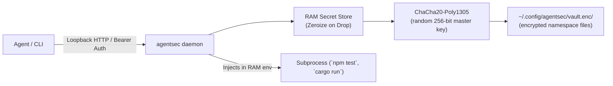

# agentsec 🔒

[](https://github.com/dkarapetyan-afk/agentsec/actions/workflows/ci.yml)
[](LICENSE-MIT)

> A secure, namespaced secret management daemon and CLI for AI coding agents and developers.

Coding agents (Codex, Grok, Gemini, Antigravity, Cursor, Claude Code, Aider, custom LLM CLI tools) frequently handle API keys, database connection strings, SSH keys, and third-party credentials. Writing `.env` files directly into workspace repositories risks accidental Git commits, leaking keys in `git diff` outputs, and exposing credentials in AI context logs.

**agentsec** solves this by maintaining secrets in an isolated, encrypted background vault outside the project directory. Agents and developers can store, query, and inject secrets into subprocess environment variables without creating plaintext workspace credential files.

---

## 🌟 Key Features

- **Namespaced Scoping**: Group secrets by project/workspace (`repo:<name>`), agent session (`agent:<session_id>`), or custom domains (`prod`, `staging`, `global`). Defaults automatically to the current Git repository!
- **Zero-File In-Memory Process Injection**: Run commands with `agentsec run -- <command>` (e.g. `agentsec run -- npm test`). Secrets are injected directly into child process RAM environment variables. No `.env` file is ever written to disk.
- **Encrypted Storage & Memory Protection**:
  - **Zeroize on Drop**: Protected secret wrappers wipe their buffers on drop; serialization copies and child environments do not provide a whole-process scrubbing guarantee.
  - **AEAD Encryption**: Storage uses ChaCha20-Poly1305 with a generated random 256-bit master key. An Argon2id derivation helper is also available in the library.
  - **Ephemeral Mode**: Pass `--ephemeral` to keep secret values and audit events in RAM. Configuration and authentication files still exist.
- **Masked Previews by Default**: List operations display safe previews (e.g. `sk-a...****...2345`) to prevent accidental leaks in terminal scrollback or agent logs.
- **Least-Privilege Tokens**: Read/write/run/admin permissions with exact namespace and key allowlists, enforced identically by REST and both MCP transports. Ordinary client tokens cannot administer other tokens; listings return metadata only.
- **Selective Injection and Output Redaction**: `run --only KEY1,KEY2` injects only selected permitted keys. Stdout/stderr redact exact injected values, including across chunks.
- **Renewable Expiring Leases**: Assign a TTL, inspect remaining lifetime, renew active temporary leases up to 24 hours from now, and proactively purge expired credentials.
- **Access Audit**: Admin-only access to recent client/operation/namespace/key/outcome metadata. No bearer tokens, values, command strings, or arguments are recorded.
- **Live Master Rotation**: `token --rotate` immediately replaces the running daemon's master credential without restart.
- **Diagnostics and Agent Setup**: `doctor` checks version/authentication/namespace/required keys/MCP; `skill install [agent]` (or `setup --agent all`) installs skill bundles for Codex, Grok, Gemini, Antigravity, Claude, Cursor, Aider, or any custom agent.
- **Daemon Supervision & Monitoring**: `service status`, `service watchdog`, and `service install` provide systemd user services, macOS launchd agents, or periodic cron tasks (`* * * * *` and `@reboot`) with automatic recovery if the daemon is offline.
- **Independent Concurrent Operations**: Async HTTP/MCP handlers and per-namespace encrypted files eliminate the vault-wide lock. Namespace contention waits asynchronously. Child processes release vault access before startup and use async waits and output streams, holding no storage worker during execution. MCP stdio reserves separate capacity for 32 commands and 64 ordinary operations; overload returns a busy error.
- **Daemonless Operations & Auto-Fallback**: Work directly against the local encrypted vault (`vault.enc`) without needing a background daemon running. All CLI subcommands and MCP stdio seamlessly fall back to direct file-locked vault access if the daemon is offline, or can be forced with `--daemonless` (`-D`) or `AGENTSEC_DAEMONLESS=1`. Use `--require-daemon` if a running daemon is mandatory.
- **Model Context Protocol (MCP) Server**: Built-in MCP stdio server (`agentsec mcp`) for plug-and-play integration with AI coding agents (works in both daemon and daemonless modes).
- **Workspace Secret Leak Scanner**: Built-in `agentsec scan` checks repository files for stored values of at least six characters; it is not a complete credential detector.

---

## 🚀 Quick Start

### 1. Build the Binary
```bash
cargo build --release
# Binary will be at target/release/agentsec
```

### 2. Start the Daemon
```bash
agentsec daemon
```

To run in ephemeral RAM-only mode (secrets exist only as long as the daemon is running):
```bash
agentsec daemon --ephemeral
```

### Upgrade from a pre-0.3 vault

Stop older agentsec processes before the one-time conversion:

```bash
agentsec migrate
```

The encrypted original remains at `vault.legacy.enc`; interrupted imports can be
resumed with the same command. The new namespace files preserve secret values,
metadata, and expiry. Restart the daemon and MCP adapters with the new binary.
Older binaries cannot open the namespace directory. No vault-wide lock is used.

### 3. Check Daemon Status
```bash
agentsec status
```
```text
Daemon Status:    ONLINE
Process ID:       12345
Version:          0.3.0
Endpoint:         http://127.0.0.1:52199
Uptime:           42s
Namespaces:       2
Active Secrets:   5
Storage Mode:     Encrypted On-Disk Vault
Vault Location:   <configured vault location>
```

---

## 💻 CLI Commands & Usage

### Storing Secrets (`agentsec set`)
```bash
# Automatically associates with current Git repository namespace (e.g., repo:my-project)
agentsec set OPENAI_API_KEY

# Store in an explicit namespace with description, tags, and a 1-hour TTL
agentsec set STRIPE_SECRET_KEY \
  --namespace repo:payment-svc \
  --description "Stripe test sandbox key" \
  --tag payments --tag sandbox \
  --ttl 3600

# Secure interactive prompt (or pipe via stdin)
agentsec set DATABASE_PASSWORD
```

### Inspecting & Getting Secrets (`agentsec get`)
```bash
# Safe inspection (displays metadata & masked preview)
agentsec get OPENAI_API_KEY

# Output raw plaintext value for piping / scripting
agentsec get OPENAI_API_KEY --raw
```

### Listing Secrets (`agentsec list`)
```bash
# List secrets in the current workspace namespace
agentsec list

# List all available namespaces
agentsec list --all-namespaces
```

### Deleting Secrets (`agentsec delete`)
```bash
# Delete a single secret
agentsec delete OPENAI_API_KEY

# Delete an entire namespace
agentsec delete --namespace repo:old-project --all-namespace
```

### Daemonless & Direct Vault Mode (`--daemonless`, `-D`)

`agentsec` is designed to be resilient and flexible:

- **Automatic Fallback (Default)**: If the background daemon process is not running, CLI commands (`get`, `set`, `list`, `run`, `doctor`, `token`, `mcp`, etc.) automatically fall back to direct local vault mode, using individual namespace file locks with nonblocking acquisition and async retry. Unrelated namespaces never share a vault lock.
- **Explicit Daemonless Execution**: Pass `--daemonless` (or `-D`) or set `AGENTSEC_DAEMONLESS=1` in your environment to operate directly against the encrypted local vault without attempting to connect to the daemon:
  ```bash
  agentsec --daemonless get OPENAI_API_KEY --raw
  agentsec -D run -- python train.py
  agentsec -D mcp
  ```
- **Strict Daemon Requirement**: If your workflow or security policy requires an active running daemon (for example, to enforce in-memory ephemeral vault policies or remote daemon endpoints), pass `--require-daemon`:
  ```bash
  agentsec --require-daemon status
  ```
  This will fail with an error if the daemon is offline instead of falling back to direct vault access.

---

## 🛡️ Subprocess Injection (`agentsec run`)

Launch any compiler, dev server, test suite, or CLI command with your secrets injected directly into its RAM environment without creating `.env` files:

```bash
# Runs test suite with all secrets from current repo namespace available via os.environ / process.env
agentsec run -- npm test

# Runs command in a clean environment (clears ambient environment variables)
agentsec run --clean-env -- python main.py

# Inject only selected keys; fail before spawning if a requested key is unavailable
agentsec run --clean-env --only API_KEY,DATA_DIR -- python main.py

# Inject from a specific namespace
agentsec run -n prod -- ./deploy.sh
```

Exact-value redaction is on by default. It does not cover encoded/transformed values,
partial values, files written by the child, or network traffic. Run permission exposes
selected credentials to that process; it is not an OS sandbox. Without `--clean-env`,
unrelated ambient credentials may remain. MCP clean mode defaults to true.

### Scoped tokens, leases, audit, and diagnostics

```bash
agentsec token create deploy -n repo:example --permission run --key API_KEY --ttl 900
agentsec token list
agentsec renew API_KEY --ttl 1800
agentsec token renew deploy --ttl 1800
agentsec audit --limit 50 --json
agentsec doctor --require API_KEY,DATA_DIR --json
```

Token creation and `token --rotate` return a raw token: capture it privately and store
it through agentsec, never in chat or workspace files. Token administration, rotation,
and audit inspection require the master or an unscoped admin token. Existing client
tokens migrate to read/write/run, not admin. Renewal sets expiry relative to now,
requires an active temporary lease, and cannot shorten or revive a lease. Creation
TTL is 1–31536000 seconds; renewal TTL is 1–86400 seconds. Externally supplied master
tokens must be rotated by their issuer. Reconnect clients after master rotation.

---

## 🤖 Model Context Protocol (MCP) Integration

Coding agents like Antigravity, Claude Code, and Cursor can talk directly to `agentsec` using its built-in MCP server.

Add the following server definition to your agent's MCP configuration (clients with other configuration formats use the same command and arguments):

```json
{
  "mcpServers": {
    "agentsec": {
      "command": "agentsec",
      "args": ["mcp"]
    }
  }
}
```

### Exposed MCP Tools
- `list_namespaces`: Lists all secret namespaces in the daemon.
- `list_secrets`: Lists secrets with metadata and masked previews in a namespace.
- `get_secret`: Fetches full secret value for tool use.
- `set_secret`: Securely stores credentials directly into daemon memory.
- `delete_secret`: Removes credentials.
- `run_command_with_secrets`: Executes shell commands with secrets injected into memory.
- `renew_secret`: Renews an active temporary lease within the 24-hour bound.
- `doctor`: Checks integration health without returning credential values.
- `get_audit_events`: Reads recent metadata, requiring admin permission.

For execution, prefer `argv: ["program", "argument"]`, `only: ["KEY"]`, and an explicit
namespace when needed. Legacy `command` strings remain supported; do not supply both.
Both stdout and stderr are redacted, with MCP captures limited to 1 MiB per stream.
HTTP MCP uses the caller's token and infers a single restricted namespace; otherwise
the default is the daemon workspace. Stdio defaults to its own client workspace.

---

## 🧠 Agent Skills

Install the embedded bundle across any AI coding agent without needing a source checkout:

```bash
# Install skills across all supported agents (Codex, Grok, Gemini, Antigravity, Claude, Cursor, Aider)
agentsec skill install

# Install for a specific agent
agentsec skill install codex
agentsec skill install claude
agentsec skill install cursor
agentsec skill install antigravity

# Install for any custom agent or directory
agentsec skill install windsurf
agentsec skill install custom --target /path/to/custom/skills/agentsec

# List all agent skill directories and their installation status
agentsec skill list

# Preview planned installs without writing files
agentsec skill install --dry-run
```

Supported default paths include:
- **Codex**: `${CODEX_HOME:-$HOME/.codex}/skills/agentsec`
- **Grok**: `${GROK_HOME:-$HOME/.grok}/skills/agentsec`
- **Gemini CLI**: `$HOME/.gemini/skills/agentsec`
- **Antigravity**: `${GEMINI_CONFIG_DIR:-$HOME/.gemini/config}/skills/agentsec`
- **Claude**: `${CLAUDE_HOME:-$HOME/.claude}/skills/agentsec`
- **Cursor**: `${CURSOR_HOME:-$HOME/.cursor}/skills/agentsec`
- **Aider**: `${AIDER_HOME:-$HOME/.aider}/skills/agentsec`
- **Shared Agent Discovery**: `$HOME/.agents/skills/agentsec`
- **Any Custom Agent**: `$HOME/.<agent>/skills/agentsec` or arbitrary path via `--target`

Existing custom files and MCP configurations are preserved, and overwritten files receive `.previous` backups. Reload skills in your agent after installation.

---

## 🔍 Workspace Leak Scanner (`agentsec scan`)

Before committing code or pushing changes, verify that no stored secret values have accidentally leaked into workspace source files:

```bash
agentsec scan
```
Output:
```text
🔍 Scanning directory "." for potential leaks of secrets from namespace 'repo:my-app'...
✅ Clean! No stored secrets detected in workspace files.
```

If a leak is found:
```text
🚨 LEAK FOUND: "./src/config.js":12: matches secret key 'STRIPE_SECRET_KEY'
🚨 CRITICAL: Found 1 potential secret leak(s) in workspace files!
Immediate action required: Remove raw credentials from files and use 'agentsec run' instead.
```

---

## 🛠️ Daemon Supervision & Monitoring (`agentsec service`)

To ensure the daemon is always active and recovers automatically if stopped or across system reboots:

### Inspect Current Supervision
```bash
agentsec service status
```
```text
╔══════════════════════════════════════════════════════════╗
║             agentsec Supervision & Monitoring            ║
╠══════════════════════════════════════════════════════════╣
║ Daemon Status:    ONLINE (PID: 242)                     ║
║ Endpoint:         http://127.0.0.1:52199                  ║
║ Uptime:           472920s                                ║
║ systemd Service:  active (enabled)                       ║
║ cron Watchdog:    Configured & Active                    ║
╚══════════════════════════════════════════════════════════╝
```

### Automatic Service Installation
```bash
# Auto-detects OS and installs systemd user service, launchd agent, or cron watchdog
agentsec service install

# Explicitly choose backend:
agentsec service install --backend systemd
agentsec service install --backend cron
agentsec service install --backend launchd

# Preview configuration without writing files:
agentsec service install --dry-run
```

### Health Watchdog & Auto-Recovery
Run a health check on demand. If the daemon is unreachable, the watchdog immediately starts it:
```bash
agentsec service watchdog
```

### Standalone Service Files & Cron Examples
Reference templates are provided in the [`contrib/`](contrib/) directory:
- **systemd user service**: [`contrib/systemd/agentsec.service`](contrib/systemd/agentsec.service)
- **systemd watchdog timer**: [`contrib/systemd/agentsec-watchdog.timer`](contrib/systemd/agentsec-watchdog.timer)
- **cron watchdog script**: [`contrib/cron/agentsec-watchdog.sh`](contrib/cron/agentsec-watchdog.sh)
- **cron configuration example**: [`contrib/cron/crontab.example`](contrib/cron/crontab.example)
- **macOS launchd agent**: [`contrib/launchd/com.agentsec.daemon.plist`](contrib/launchd/com.agentsec.daemon.plist)

---

## 🔐 Security Architecture



1. **Storage At Rest**: Secrets are saved as separate encrypted namespace files inside `~/.config/agentsec/vault.enc/`, using ChaCha20-Poly1305 and private directory/file permissions. The master key is derived or generated with 256 bits of entropy and stored with `0600` permissions.
2. **Storage In Transit**: Daemon defaults to localhost (`127.0.0.1`) with a cryptographically random bearer token. Host overrides are supported; use TLS and scoped tokens for remote access.
3. **Storage In Memory**: Protected secret wrappers implement `zeroize::ZeroizeOnDrop`; this does not guarantee scrubbing of every temporary copy or child environment.
4. **Leak Prevention**: Redacted string formatting (`[SECRET_REDACTED]`) prevents accidental output in debug logs.

---

## 🤝 Contributing & Community

Contributions are welcome! Please check out:
- [Contributing Guide](CONTRIBUTING.md) for build, testing, and pull request workflows.
- [Code of Conduct](CODE_OF_CONDUCT.md) for community standards.
- [Security Policy](SECURITY.md) for responsible vulnerability disclosure.

---

## 📄 License

Dual-licensed under either:
- Apache License, Version 2.0 ([LICENSE-APACHE](LICENSE-APACHE))
- MIT License ([LICENSE-MIT](LICENSE-MIT))

at your option.
